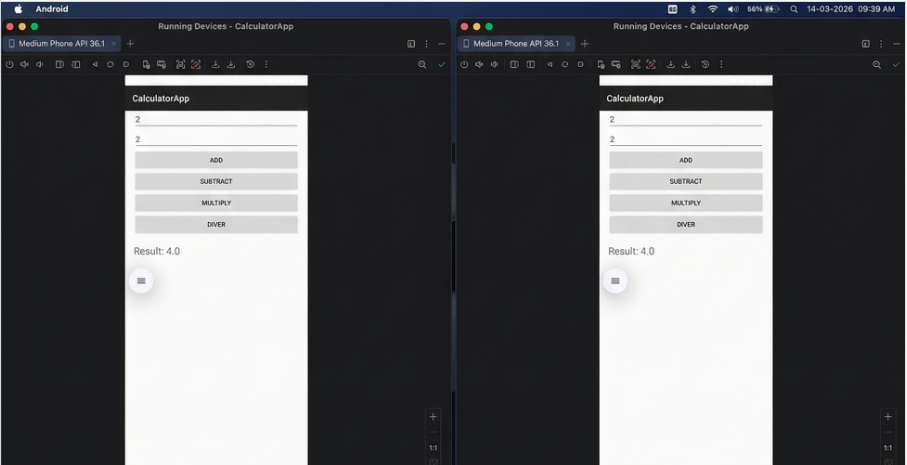
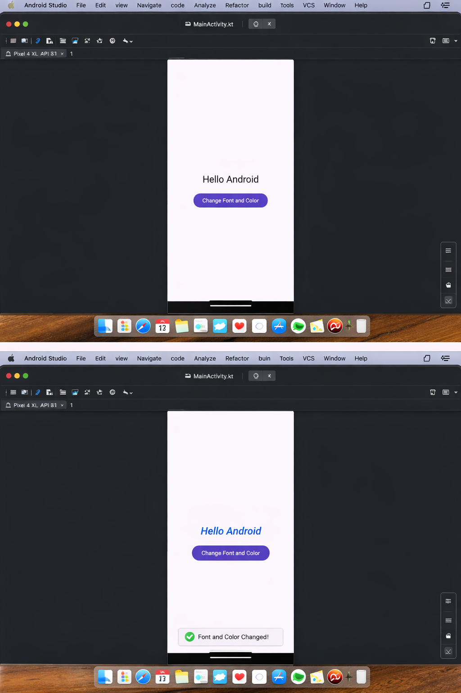
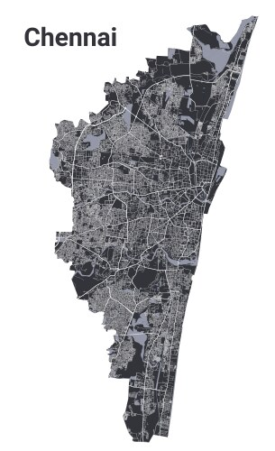

# Web Technology and Mobile Applications Laboratory

[](https://developer.mozilla.org/en-US/docs/Web)
[](https://react.dev/)
[](https://jakarta.ee/)
[](https://developer.android.com/)
[](#)
[](#)

## 1. Project Title
**Web Technology and Mobile Applications Laboratory: Client-Side Web Portals, Java Servlets, Native Android Development, and Modern React Single Page Application**

## 2. Project Overview
This repository contains a comprehensive academic laboratory and project portfolio for **Web Technology and Mobile Applications**, developed within the Department of Artificial Intelligence and Machine Learning at Rajalakshmi Engineering College.

The repository is structured into two distinct parts:

### Part I: Academic Laboratory Coursework (Experiments 1–9)
1. **Core Web Technologies (Exp 1 & 2)**: Multi-page web portal for Chennai Insurance Centers implemented in pure HTML tables/framesets and styled with CSS layouts, alongside a client-side registration form with JavaScript regex validation.
2. **Server-Side Web Architecture (Exp 3–6)**: Java HTTP Servlets (`HttpServlet`) handling GET and POST request methods, parameter parsing, dynamic HTML generation via `PrintWriter`, and deployment on Apache Tomcat.
3. **Native Android Mobile Development (Exp 7–9)**: Android Studio layout and component files engineered in XML and Kotlin—including a basic calculator interface, a dynamic runtime font/color styling app, and Android activity exploration.

### Part II: React Capstone Application (`Online Insurance Management.zip`)
A modern client-side Single Page Application (SPA) prototype for an **Online Insurance Management Platform**, developed with **React 19** and **Vite 8**. The application features client-side state management using **Zustand**, data presentation with **TanStack Table** and **TanStack Query**, interactive charting via **Recharts**, and UI animations powered by **Framer Motion**.
> [!NOTE]
> The React capstone project operates entirely on the client side using local browser storage (`localStorage`) and mock data for authentication and policy metrics; it does not connect to an external live database or remote production backend.

---

## 3. Objectives
- Design structured, multi-page web portals using semantic HTML5 and CSS.
- Implement client-side form validation using JavaScript regex patterns and DOM manipulation.
- Build server-side HTTP request handlers using Java Servlets (`doGet`, `doPost`), exploring form submission workflows.
- Author native Android XML layouts (`activity_main.xml`) and interactive event-handling logic in Kotlin.
- Construct modern client-side user interfaces utilizing component-driven frontend libraries (React 19, Vite, and Zustand).

---

## 4. Repository Highlights / Key Features

### Academic Coursework Modules (Experiments 1–9)
- **Multi-Page Chennai Insurance Portal (Exp 1)**:
  - Multi-zone information portal covering Chennai zones (Central, East, West, North, South, Northeast, Southwest, LIC, HDFC).
  - Contrasting implementations: pure HTML table/frame structure versus CSS layout styling.
- **Client-Side Validated Registration Form (Exp 2)**:
  - Form validation rules checking username length, email pattern matching, password equality, numeric age bounds, and 10-digit mobile phone length.
- **Java Servlet Request Handling (Exp 3–6)**:
  - Dynamic content generation using `PrintWriter`.
  - Contrasting HTTP `GET` query parameters with HTTP `POST` body payloads.
  - Complete standalone `GetPostServlet.java` alongside documented PDF records.
- **Native Android Applications (Exp 7–9)**:
  - *Calculator App*: Grid layout with arithmetic operation buttons (+, -, *, /) and clear functions.
  - *Font & Color Customizer App*: Interactive UI modifying text font size, typeface, and color palette dynamically at runtime in Kotlin.

### React Capstone Application (`Online Insurance Management.zip`)
- **React-Based Single Page Application Architecture**:
  - Component hierarchy: `DashboardOverview`, `PolicyList`, `PolicyCard`, `ClaimsTracker`, `PaymentHistory`, `AnalyticsDashboard`, `AdminPanel`, and `PremiumCalculator`.
  - Client-side state store powered by **Zustand** managing authentication status, theme preferences (light/dark mode), and user profile state.
  - Interactive data tables with sorting and pagination via **@tanstack/react-table**.
  - Metric visual charts built using **Recharts**.
  - Animated UI transitions powered by **Framer Motion**.

---

## 5. Technologies and Tools

### Academic Laboratory Coursework
- **Languages**: HTML5, CSS3, JavaScript (ES6), Java (JDK 17), Kotlin
- **Server Platform**: Jakarta / Java Servlet API (`javax.servlet.http.HttpServlet`), Apache Tomcat (v9.x / v10.x)
- **Mobile Development**: Android SDK (API Level 31+), Android Studio, Android XML Layouts

### React Capstone Project (`Online Insurance Management.zip`)
- **Core Framework**: React 19.2.5, React DOM 19.2.5
- **Build Tool & Bundler**: Vite 8.0.10, `@vitejs/plugin-react` 6.0.1
- **State Management**: Zustand 5.0.13
- **Data & Tables**: `@tanstack/react-query` 5.100.9, `@tanstack/react-table` 8.21.3
- **Visualization**: Recharts 3.8.1
- **Animation & Icons**: Framer Motion 12.38.0, Lucide React 1.14.0
- **Form Handling & Validation**: React Hook Form 7.75.0, Zod 4.4.3
- **Routing & Notifications**: React Router DOM 7.14.2, Sonner 2.0.7
- **Linting**: ESLint 10.2.1

---

## 6. Project Structure
```text
WEB-TECHNOLOGY-AND-MOBILE-APPLICATIONS/
│
├── Web Page (EXP 1)/                       # Experiment 1: Multi-Page Web Portal (Chennai Insurance Centers)
│   ├── Web Page (without css)/             # Part A: Pure HTML table/frame-based portal
│   │   ├── index.html
│   │   └── tamilnadu.jpg
│   └── Web Page (with css)/                # Part B: Styled multi-zone portal with CSS layout
│       ├── index.html
│       ├── style.css
│       ├── about.html, central.html, east.html, north.html, south.html, west.html...
│       └── car.jpg, health.jpg, life.jpg, chennai.jpg, Chennai.jpeg
│
├── Registration Page(EXP 2 )/              # Experiment 2: Registration Form with Client-Side Validation
│   ├── EXP 2 HTML/                         # Part A: Pure HTML registration form
│   │   └── Registration page.html
│   └── EXP 2 HTML WITH CSS/                # Part B: Form with CSS styling & JavaScript validation
│       ├── index.html
│       ├── style.css
│       └── script.js.txt
│
├── Servlet Program(EXP 3)/                 # Experiment 3: HelloWorld Java Servlet
│   └── EXP 3.pdf                           # Documented HttpServlet code, web.xml mapping & Tomcat output
│
├── Login Form (EXP 4)/                     # Experiment 4: User Login Form and UserServlet
│   └── EXP 4.pdf                           # Documented HTML login form and POST handling servlet
│
├── EXP 5/                                  # Experiment 5: HTTP GET vs. POST Request Handling
│   └── EXP 5.pdf                           # Documented MethodServlet comparing query vs. body parameters
│
├── EXP 6/                                  # Experiment 6: Standalone Java Servlet & HTML Form
│   ├── form.html                           # HTML form invoking GET/POST servlet
│   └── GetPostServlet.java                 # Standalone HttpServlet implementation
│
├── EXP 7/                                  # Experiment 7: Native Android Calculator Application
│   ├── AndroidManifest.xml(...)            # Exported manifest configuration
│   ├── Themes.xml(...)                     # Application styling themes
│   ├── activity_main.xml(...)              # Calculator grid layout
│   └── Screenshot 2026-04-21 135207.png     # Verified Android emulator execution screenshot
│
├── EXP 8/                                  # Experiment 8: Android Dynamic Font & Color Customizer
│   ├── AndroidManifest.xml(...)            # Manifest configuration
│   ├── Activity_main.xml(...)              # Application layout
│   ├── MainActivity.kt(...)                # Kotlin event-driven styling logic
│   └── output.png                          # Verified Android emulator execution screenshot
│
├── EXP 9/                                  # Experiment 9: Android UI & Component Exploration
│   ├── AndroidManifest.xml(...)
│   ├── MainActivity.kt(...)
│   └── output.png
│
├── Online Insurance Management.zip         # React Capstone: React 19 + Vite 8 SPA application archive
│
├── docs/
│   └── images/                             # Verified screenshots and visual assets
│       ├── exp7_android_calculator_ui.png
│       ├── exp8_android_font_color_ui.png
│       ├── insurance_platform_hero.png
│       └── exp1_chennai_portal_map.jpg
│
└── README.md                               # Comprehensive laboratory curriculum and execution guide
```

---

## 7. Prerequisites and Installation

### Web & Java Environment
- Modern web browser (Google Chrome, Microsoft Edge, Mozilla Firefox).
- Java Development Kit (JDK 17 LTS or newer).
- Apache Tomcat (v9.x or v10.x) for running Java Servlets.
- Node.js (v18.x or v20.x LTS) and npm for the React application.

### Android Mobile Environment
- Android Studio (Ladybug, Hedgehog, Flamingo, or newer).
- Android SDK (API Level 31 or higher, recommended API 33/34) with an Android Virtual Device (AVD) emulator.

---

## 8. Execution Instructions & Reference Workflows

### 1. Launching Static Web Pages (Experiments 1 & 2)
Open the HTML files directly in your web browser:
```bash
# On Windows PowerShell:
Start-Process "Web Page (EXP 1)\Web Page (with css)\index.html"
Start-Process "Registration Page(EXP 2 )\EXP 2 HTML WITH CSS\index.html"
```

### 2. Compiling and Deploying Java Servlets (Experiments 3–6)
To deploy `GetPostServlet.java` (Exp 6) or servlets from the PDF records to Apache Tomcat:
```bash
# Compile using servlet-api.jar from Tomcat lib:
javac -cp "C:\apache-tomcat-9.0\lib\servlet-api.jar" -d WEB-INF/classes GetPostServlet.java

# Place compiled classes into Tomcat's webapps directory and start Tomcat:
catalina.bat run
```

### 3. Running Android Projects (Experiments 7–9)
The repository contains the exported layout XML, Kotlin source, themes, and manifest files. To run them in Android Studio:
1. Open Android Studio and create a new project with an **Empty Activity** (Kotlin).
2. Replace or merge `res/layout/activity_main.xml` and `MainActivity.kt` with the files provided in `EXP 7` or `EXP 8`.
3. Verify that `AndroidManifest.xml` references the main activity with the launcher intent filter.
4. Run the project on an Android Virtual Device (AVD) emulator or connected hardware device.

### 4. Running the React Insurance Platform (Capstone)
1. Extract `Online Insurance Management.zip` into a project folder:
   ```bash
   unzip "Online Insurance Management.zip" -d insurance-platform
   cd insurance-platform/insurance-platform
   ```
2. Install dependencies using Node.js 18+ or 20+ LTS:
   ```bash
   npm install
   ```
3. Start the local Vite development server:
   ```bash
   npm run dev
   ```
4. Navigate to `http://localhost:5173` in your browser.

---

## 9. Implementation Details: Complete Experiment & Project Index

| Exp No. / Project | Module Title | Primary Files / Directory | Core Concepts & Features | Technology Stack | Key Output / Verification |
|:---:|---|---|---|---|---|
| **01** | Multi-Page Web Portal | [Web Page (EXP 1)](Web%20Page%20%28EXP%201%29/Web%20Page%20%28with%20css%29/index.html) | Multi-page site navigation, zonal center directory, CSS layouts | HTML5, CSS3 | Centered Chennai insurance center portal |
| **02** | Registration Page & Validation | [Registration Page(EXP 2 )](Registration%20Page%28EXP%202%20%29/EXP%202%20HTML%20WITH%20CSS/index.html) | Client-side validation for email, password match, mobile length, age | HTML5, CSS3, JavaScript | Interactive validation alerts and feedback |
| **03** | HelloWorld Servlet | [Servlet Program(EXP 3)](Servlet%20Program%28EXP%203%29/EXP%203.pdf) | `HttpServlet`, `doGet()`, `PrintWriter`, URL mapping (`/HelloWorld`) | Java Servlet, Tomcat | Browser output: "Hello World from Servlet" |
| **04** | User Login Form | [Login Form (EXP 4)](Login%20Form%20%28EXP%204%29/EXP%204.pdf) | HTML form submission, `doPost()`, request parameter extraction | HTML, Java Servlet | Processed login credentials display |
| **05** | HTTP GET vs. POST Demonstration | [EXP 5](EXP%205/EXP%205.pdf) | Query string parameters vs. HTTP request body payload handling | HTML, Java Servlet | Parameter comparison in server response |
| **06** | Standalone GET/POST Servlet | [EXP 6](EXP%206/GetPostServlet.java) | Dual-method handling in a single servlet (`doGet` & `doPost`) | Java Servlet, HTML | Standalone servlet processing form data |
| **07** | Android Calculator Application | [EXP 7](EXP%207/activity_main.xml%28res-_layout-_activity_main%29_) | Grid UI layout, Button widgets, arithmetic operations | Android XML, Themes | Verified Android emulator calculator UI |
| **08** | Dynamic Font & Color Customizer | [EXP 8](EXP%208/MainActivity.kt%28app-_Kotlin%2Bjava-_com.example.fontcolorapp-_mainactivity.kt%29_) | Runtime UI modification, Kotlin event listeners, color palettes | Kotlin, Android XML | Interactive runtime font & color changes |
| **09** | Android Component Exploration | [EXP 9](EXP%209/MainActivity.kt%28app-_Kotlin%2Bjava-_com.example.fontcolorapp-_mainactivity.kt%29_) | Android manifest permissions, activity lifecycle, Kotlin events | Kotlin, Android XML | Custom UI rendering on Android emulator |
| **Capstone** | **Online Insurance Management** | [Online Insurance Management.zip](Online%20Insurance%20Management.zip) | React 19 SPA: Dashboard, Policies, Claims, Analytics, Admin Panel | React 19, Vite 8, Zustand | Interactive single-page web application |

---

## 10. Results and Outputs
- **Chennai Insurance Portal (Exp 1)**: Renders a navigation portal connecting zonal subpages across Chennai with localized center addresses and insurance partner links (LIC, HDFC).
- **Form Validation (Exp 2)**: Client-side JavaScript validation checks form fields in real time, alerting users when passwords do not match or phone numbers do not match 10 digits.
- **Java Servlets (Exp 3–6)**: Compiled and executed on Apache Tomcat, demonstrating request parameter parsing and dynamic HTML response generation for both GET and POST requests.
- **Android Calculator App (Exp 7)**: Verified on the Android emulator, displaying numeric buttons and evaluating arithmetic expressions.
- **Android Font & Color App (Exp 8)**: Verified on the Android emulator, updating TextView font sizes and color schemes dynamically upon button click events.
- **React Insurance Management Platform (Capstone)**: Fully configured React Single Page Application utilizing local Zustand state and client-side routing, featuring animated tab views, claim status cards, and metric charts.

---

## 11. Screenshots and Visual Documentation

### Experiment 7: Android Calculator Application (Emulator Execution)


### Experiment 8: Android Font & Color Customizer Application (Emulator Execution)


### Capstone Project: Online Insurance Management Platform (Hero Asset)


### Experiment 1: Chennai Insurance Centers Geographic Portal Map


---

## 12. Concepts and Learning Outcomes
- Developed familiarity with foundational web document authoring and CSS styling techniques.
- Understood client-side input validation workflows using regular expressions.
- Gained practical exposure to server-side Java Servlet request lifecycles and HTTP methods.
- Explored native Android mobile development concepts, XML interface layout design, and Kotlin event handling.
- Acquired hands-on experience building modern component-based single-page user interfaces with React 19, Vite, and Zustand.

---

## 13. Future Improvements
- Refactor the static Chennai insurance portal to use modern CSS Flexbox and CSS Grid layout techniques.
- Migrate Java Servlets to a modern Spring Boot RESTful backend architecture.
- Expand the Android calculator application into a complete Gradle project with Unit tests.
- Connect the React insurance application to a live RESTful API or Firebase database backend for persistent data storage.

---

## 14. Author Information
**Rohita M**  
- **GitHub**: [@rohitam26](https://github.com/rohitam26)  
- **Academic Program**: B.E. Artificial Intelligence and Machine Learning  
- **Institution**: Rajalakshmi Engineering College  
